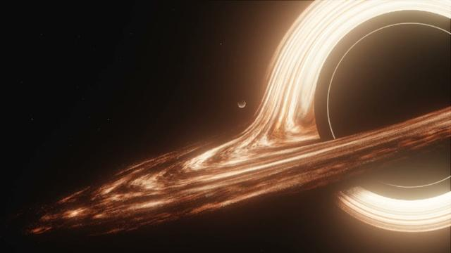

# Gargantua — Real-Time Relativistic Black Hole Raytracer

An interactive, physically-accurate WebGL2 / Three.js simulation of a supermassive Kerr black hole, gravitational lensing, relativistic accretion disk dynamics, and time dilation inspired by Christopher Nolan's *Interstellar* and Kip Thorne's astrophysical calculations.



## Features

- **Relativistic Geodesic Raymarching**:
  - Exact Kerr and Schwarzschild gravitational deflection using conserved coordinate angular momentum ($h^2 = |r \times v|^2$).
  - Analytical geodesic bypass for asymptotic cosmos rays ($\Delta\phi$ 3rd-order GR expansion), eliminating 40–50% of raymarching steps.
  - Razor-sharp event horizon ($r_{eh} = 1.005\,R_s$) and circular sky porthole near horizon infall ($r \to 1.015\,R_s$).
- **Accretion Disk Astrophysics**:
  - Lin-Shu logarithmic spiral density waves with Keplerian differential velocity shear.
  - Relativistic Doppler beaming and gravitational redshift.
  - Gaussian vertical density with path-length opacity scaling ($1 / |\hat{r}_y|$).
  - Embers and dust filaments with sub-pixel footprint filtering.
- **Miller's Ocean Planet**:
  - Procedural atmospheric turbulence, planetary shadow cutout, and dynamic orbit at $r = 5.6\,R_s$.
  - Relativistic time dilation (1 hour on Miller's planet $\approx$ 7 Earth years).
- **Acoustic Physics & Sonification**:
  - Real-time gravitational audio warping of NASA Chandra Perseus cluster black hole sonification.
  - Physical blueshift scaling $\gamma_{\text{audio}} = 1/\sqrt{\max(0.0005, 1 - 1/r)}$.
  - Seamless loop with equal-power crossfade and brickwall dynamics compressor.
- **Performance & Thermal Governor**:
  - Intuitive Quality Scaling: **Eco** (adaptive DPR 0.75, 72 steps, 60 FPS) and **HQ** (native DPR 1.0, 100 steps).
  - Dynamic idle governor dropping to 30 FPS after 4s inactivity to keep laptops cool.
- **Bilingual Internationalization (RU / EN)**:
  - 100% live bilingual UI, HUD telemetry, and notifications with zero WebGL reload.

## Project References & Attributions

- **Audio Sonification & NASA Chandra Data**:  
  **Credit**: NASA/CXC/SAO/K.Arcand, SYSTEM Sounds (M. Russo, A. Santaguida).  
  Acoustic pressure waves discovered by the Chandra X-ray Observatory in the Perseus cluster core (57 octaves below middle C) transposed into audible range.  
  Release: [https://chandra.si.edu/photo/2022/sonify5/](https://chandra.si.edu/photo/2022/sonify5/)  
  Chandra Media Use Policy: [https://chandra.si.edu/about/copyright.html](https://chandra.si.edu/about/copyright.html)  
  Full license documentation: [`AUDIO_LICENSE.md`](AUDIO_LICENSE.md) and [`public/audio/LICENSE.txt`](public/audio/LICENSE.txt).
- **Raytracer Mathematics & Numerical Integration**:  
  Otto Seiskari's WebGL Black Hole Raytracer ([GitHub: oseiskar/black-hole](https://github.com/oseiskar/black-hole)). Preserved for technical reference in [`public/oseiskar_raytracer.glsl`](public/oseiskar_raytracer.glsl).
- **Background Celestial Skybox**:  
  European Southern Observatory (ESO) / NASA Milky Way 360° equirectangular celestial panorama.

## Local Development

```bash
# Install dependencies
npm install

# Run local development server
npm run dev

# Build production bundle
npm run build
```
